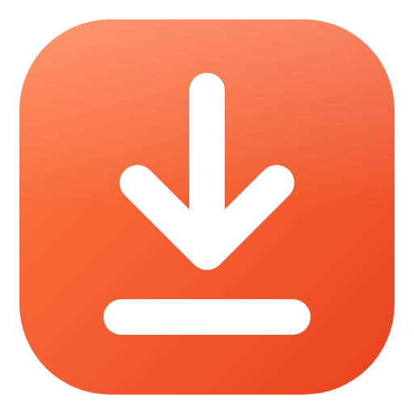
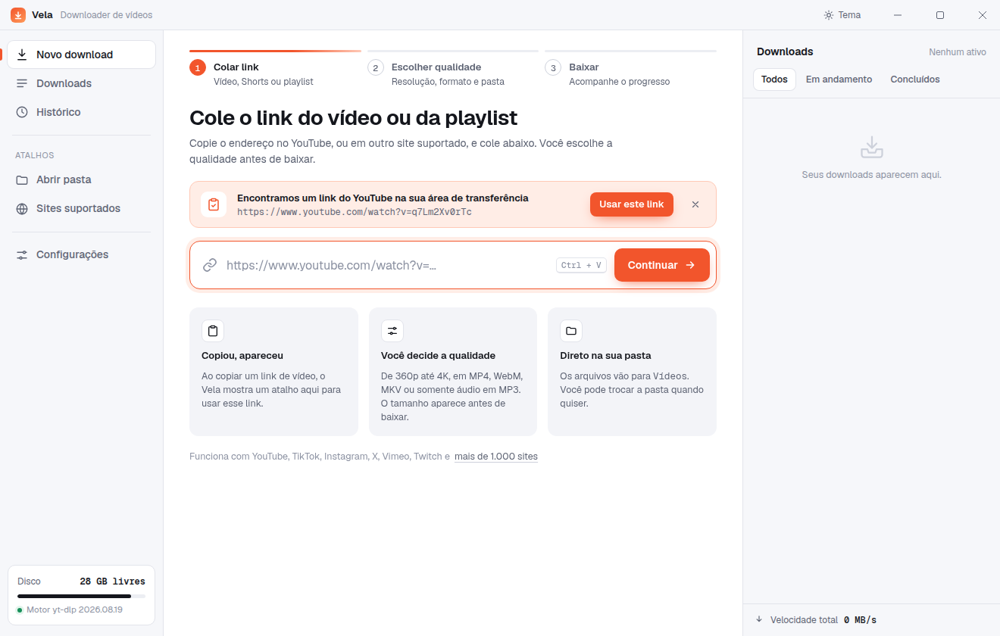
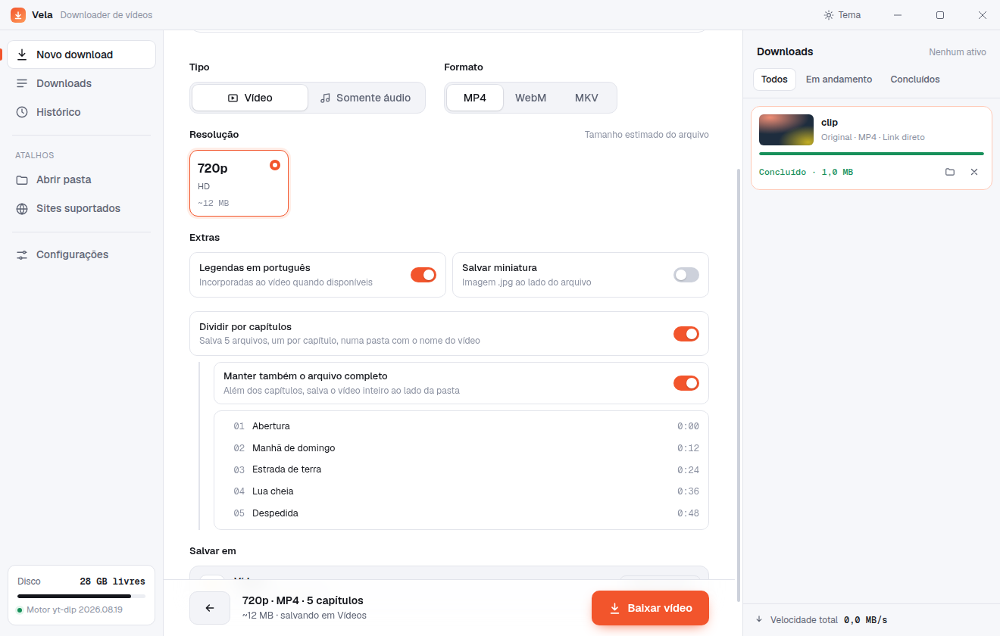
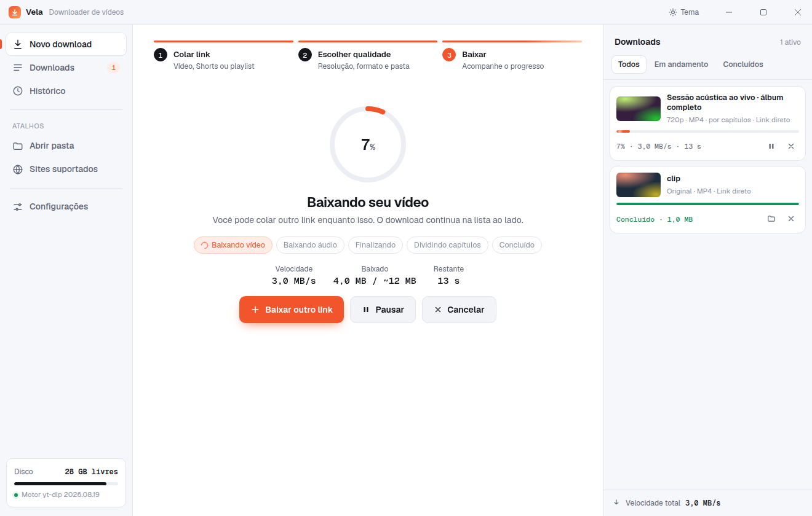
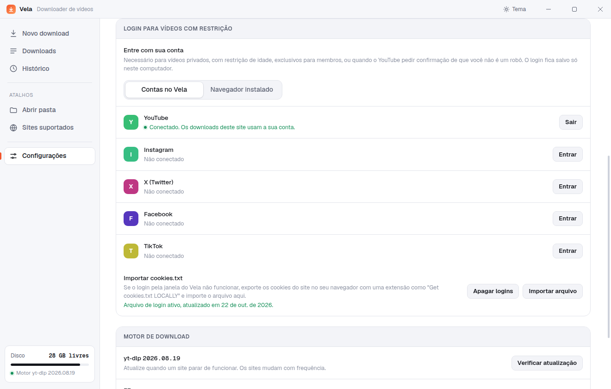
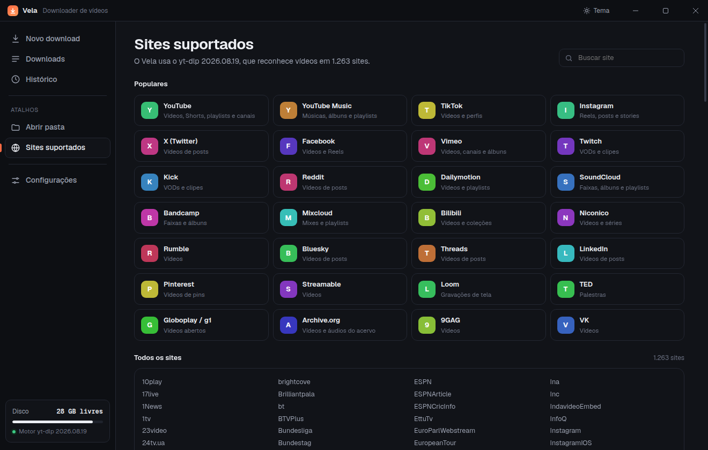

<p align="center">
  
</p>

<h1 align="center">Vela Downloader</h1>

<p align="center">
  Baixe vídeos e playlists do YouTube e de mais de mil outros sites, com a qualidade que você escolher.<br>
  Aplicativo gratuito e de código aberto para Windows.
</p>

<p align="center">
  <a href="https://github.com/luizolliver/youtube-dl/releases/latest"><b>Baixar para Windows</b></a>
  ·
  <a href="CHANGELOG.md">Novidades</a>
  ·
  <a href="https://github.com/luizolliver/youtube-dl/issues">Relatar um problema</a>
</p>



## O que ele faz

- **Três passos:** colar o link, escolher a qualidade, baixar.
- **Detecta links copiados:** ao copiar um link de um site conhecido, o Vela mostra um atalho para usá-lo. Você pode desligar isso em Configurações.
- **Qualidade antes de baixar:** o app lista as resoluções que o vídeo realmente tem, de 144p até 8K, com o tamanho estimado de cada uma. Os formatos de vídeo são MP4, WebM e MKV; os de áudio são MP3, M4A e OPUS, de 128 a 320 kbps.
- **Playlists:** marque só os vídeos que quiser. Eles são salvos numa pasta com o nome da playlist, numerados na ordem.
- **Dividir por capítulos:** em vídeos com capítulos, cria um arquivo por capítulo numa pasta com o nome do vídeo. Funciona em vídeo e em áudio, o que é útil para álbuns completos.
- **Vídeos com restrição:** entre com sua conta do YouTube, Instagram, X, Facebook ou TikTok para baixar vídeos privados, com restrição de idade ou só para membros.
- **Progresso em tempo real:** porcentagem, velocidade, tempo restante e etapa atual, também no ícone da barra de tarefas.
- **Fila de downloads:** de 1 a 4 downloads ao mesmo tempo, com pausar, continuar e cancelar.
- **Pasta de destino:** o padrão é a pasta **Vídeos** do Windows, e você pode trocar quando quiser.
- **Histórico** com busca, **tema claro e escuro** e **notificação** quando um download termina.

| Escolher a qualidade | Acompanhar o download |
| --- | --- |
|  |  |

| Login para vídeos com restrição | Sites suportados, no tema escuro |
| --- | --- |
|  |  |

## Instalação

1. Baixe o arquivo `Vela-Downloader-Setup-<versão>.exe` na [página de releases](https://github.com/luizolliver/youtube-dl/releases/latest).
2. Abra o instalador e siga os passos.

O instalador ainda não tem assinatura digital, então o Windows SmartScreen pode mostrar **"O Windows protegeu o computador"**. Para continuar, clique em **Mais informações** e depois em **Executar assim mesmo**. O instalador é gerado a partir deste repositório pelo [workflow de release](.github/workflows/release.yml).

Requer Windows 10 ou 11, 64 bits. Na primeira vez que o app abre, ele prepara o motor de download, o que leva alguns segundos.

## Sites suportados

O Vela aceita qualquer site suportado pelo [yt-dlp](https://github.com/yt-dlp/yt-dlp): cerca de 1.600 extratores, que cobrem mais de 1.200 sites. Entre os mais usados estão:

YouTube (vídeos, Shorts, playlists e canais), YouTube Music, TikTok, Instagram, X/Twitter, Facebook, Vimeo, Twitch, Kick, Reddit, Dailymotion, SoundCloud, Bandcamp, Mixcloud, Bilibili, Niconico, Rumble, Bluesky, Threads, LinkedIn, Pinterest, Streamable, Loom, TED, Globo, Archive.org e VK.

A lista completa, com busca, fica na tela **Sites suportados** do app. Ela vem do próprio motor instalado, então cresce quando o motor é atualizado. Links de sites fora da lista também podem funcionar, porque o yt-dlp tenta encontrar o vídeo na página.

Quando um site para de funcionar, quase sempre basta atualizar o motor: **Configurações → Motor de download → Verificar atualização**.

## Vídeos que exigem login

Vídeos privados, com restrição de idade ou exclusivos para membros exigem login. O YouTube também pode pedir a confirmação "não sou um robô". Nesses casos, o Vela mostra o botão **Entrar com o YouTube** ao lado do erro. Ele também fica em **Configurações → Login para vídeos com restrição**.

- **Contas no Vela (padrão):** ao clicar em **Entrar**, o Vela abre o Google Chrome, o Microsoft Edge ou o Brave instalado no PC, nessa ordem de preferência, num perfil separado que só o Vela usa. É uma janela comum do navegador, sem nenhuma flag de automação, então o Google aceita o login. Depois de entrar, feche a janela ou clique em **Concluir login** no Vela. O Vela abre esse perfil em segundo plano, lê os cookies do site pelo protocolo DevTools do próprio navegador, salva em `%APPDATA%\Vela\cookies.txt` e fecha. O yt-dlp lê esse arquivo com `--cookies`. Sem nenhum desses navegadores, o login abre numa janela do Vela, o que funciona na maioria dos sites, mas o Google recusa.
- **Importar cookies.txt:** exporte os cookies no seu navegador com uma extensão como "Get cookies.txt LOCALLY" e importe o arquivo. Os logins importados se juntam aos que já existem.
- **Navegador instalado:** o yt-dlp lê o login direto do navegador (`--cookies-from-browser`). No Windows, o Firefox é o mais confiável. As versões recentes do Chrome e do Edge protegem os cookies e geralmente não funcionam.

Os logins ficam só no seu computador. **Configurações → Apagar logins** remove todos.

## Para desenvolvedores

Requisitos: Windows 10 ou 11 e [Node.js](https://nodejs.org) 20 ou mais recente.

```bash
npm install
npm start          # abre o app em modo de desenvolvimento
npm run check      # verifica a sintaxe dos arquivos
npm run dist       # gera o instalador em dist/ (rode no Windows)
```

- Na primeira execução, o app baixa o `yt-dlp.exe` mais recente para `%APPDATA%\Vela\bin`. O FFmpeg vem do pacote `ffmpeg-static`, que instala o binário da plataforma em que o `npm install` roda. Por isso o instalador do Windows precisa ser gerado no Windows.
- Em modo de desenvolvimento, o Vela cria no Menu Iniciar o atalho **Vela (desenvolvimento)**. O Windows usa esse atalho para mostrar o nome e o ícone do Vela nas notificações.
- `npm run dist` baixa o `yt-dlp.exe` para `resources/bin`, que vai embutido no instalador, e gera `dist/Vela-Downloader-Setup-<versão>.exe` com o electron-builder (NSIS).

### Publicar uma versão

1. Atualize `version` no `package.json` e adicione a seção da versão no `CHANGELOG.md`.
2. Faça o commit e crie a tag: `git tag v1.0.0 && git push origin v1.0.0`.
3. O [workflow de release](.github/workflows/release.yml) gera o instalador num Windows do GitHub Actions e publica a release com o texto do `CHANGELOG.md`.

### Decisões técnicas

- **Runtime JavaScript para o YouTube:** o yt-dlp precisa de um runtime JavaScript para ler os formatos do YouTube. Em vez de pedir que o usuário instale o Deno, o Vela passa o próprio executável com `ELECTRON_RUN_AS_NODE=1` (`--js-runtimes node:<Vela.exe>`).
- **Compatibilidade do MP4:** quando o formato é MP4, o Vela prefere H.264 com áudio AAC (`-S res:<altura>,vcodec:h264,ext:mp4:m4a`), que tocam em qualquer player do Windows. Acima de 1080p, o YouTube só oferece VP9 e AV1, e o Vela usa esses codecs.
- **Motor atualizável:** o yt-dlp fica na pasta de dados do usuário, e "Verificar atualização" roda `yt-dlp -U`.
- **Mensagens de erro em português:** os erros do yt-dlp viram mensagens que dizem o que fazer, e os que um login resolve oferecem o botão de entrar.

### Estrutura

```
src/main/main.js           janela, IPC, área de transferência, notificações
src/main/ytdlp.js          instalação do motor, leitura de metadados, downloads e progresso
src/main/downloads.js      fila com pausar, continuar e cancelar
src/main/settings.js       configurações e histórico (JSON em %APPDATA%\Vela)
src/main/auth.js           logins por site e o cookies.txt usado pelo yt-dlp
src/main/browser-login.js  abre o Chrome/Edge com o perfil do Vela e lê os cookies via DevTools
src/main/sites.js          sites populares e detecção de links
src/preload/preload.js     ponte segura entre a interface e o processo principal
src/renderer/              interface (HTML, CSS e JS, sem framework)
mockup/index.html          mockup que serviu de base para a interface
scripts/                   download do yt-dlp para o instalador e notas de release
```

Contribuições são bem-vindas. Veja o [CONTRIBUTING.md](CONTRIBUTING.md).

## Aviso

O Vela Downloader é uma interface para o yt-dlp e não tem relação com o YouTube nem com os outros sites suportados. Baixe apenas conteúdo que você tem direito de salvar e respeite os termos de uso de cada site.

## Licença

[MIT](LICENSE) © luizolliver. O instalador inclui componentes de terceiros com licenças próprias, entre eles o yt-dlp (Unlicense) e o FFmpeg (GPL v3). Veja [THIRD_PARTY_NOTICES.md](THIRD_PARTY_NOTICES.md).
